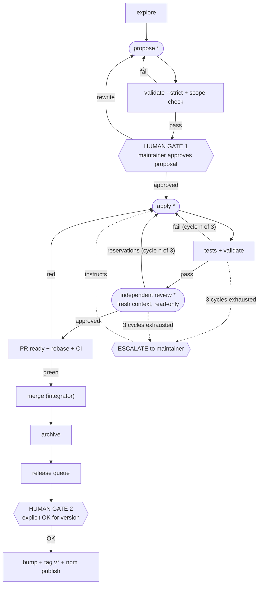
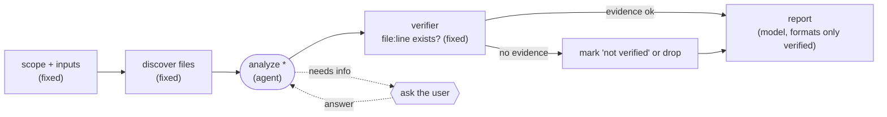

# The AEP delivery graph

This page documents how a change travels through this repository, from idea to published capability, as an explicit graph. It implements the OpenSpec change `define-aep-delivery-graph` (spec: `openspec/changes/define-aep-delivery-graph/specs/aep-delivery-graph/spec.md`; the decisions it mentions are in that change's `design.md`).

Related pages: [roles](roles.md), [repository protection](repository-protection.md), [engagement workspaces](engagement-workspaces.md), [context budget](context-budget.md).

## What "AEP" means here

**AEP (Agentic Engineering Platform) is a working definition of this project. It is not an industry standard**, and nothing on this page says it is. It is anchored in two sources and adapted by us. The line between the two is kept explicit.

### What the sources state (attributed)

- Weave Intelligence, ["What is an Agentic Engineering Platform?"](https://weaveintelligence.io/blog/what-is-an-agentic-engineering-platform) (Kaspar von Grünberg, 2026). An AEP is built and run by a platform engineering team so that engineers and agents develop together. It evolves the internal developer platform (IDP) and supplies paths, interfaces and guardrails at an autonomy level the organization sets. It has three layers: Tooling; Path specifications (probabilistic, deterministic and hybrid paths, where a deterministic gate evaluates an agent's candidate and failures route back to the agent); and Agent Infrastructure (a harness with execution, context, capability and evaluation; governance with identity, agent security and agent observability; and models). It describes four autonomy levels. Its stated audience is typically 50+ developers, and it says there is no AEP without a good IDP. Its worked example uses LangGraph; that is the source's choice, not a requirement we inherit.
- CNCF blog, ["Platform engineering for the agentic enterprise: managing applications, resources, and AI agents"](https://www.cncf.io/blog/2026/07/21/platform-engineering-for-the-agentic-enterprise-managing-applications-resources-and-ai-agents/) (Lakmal Warusawithana, WSO2, 2026-07-21). Applications, resources and AI agents are first-class entities of one platform; every actor has a distinct identity, scoped permissions and an audit trail; context is a first-class capability; reusable skills and built-in agents encapsulate engineering tasks. It is conceptual and, as read, it does not define the term "AEP".

Neither source endorses this project's definition, and this repository does not claim to conform to either source's architecture or layers.

### Our adaptation for a consultancy (not stated by either source)

For a consultancy that delivers assessments, architectures and platforms to third parties, an AEP is **the set of reusable, versioned and verifiable capabilities (skills, agents, specs, checks), plus the paths and guardrails through which people and agents deliver engagements, with evidence and an audit trail per engagement.**

| Concern | What it means for a consultancy | What this repository provides |
|---|---|---|
| Reusable capabilities | A catalog reused across engagements | Provided: the repository and its marketplace under `plugins/` |
| Contract | Scope and acceptance written as a spec before work starts | Provided: OpenSpec changes and specs, and human gate 1 |
| Verifiable evidence | A finding is a finding only if it points to evidence | Provided: the level 2 verifier node and the evidence rule |
| Governance | Who may write where, when to stop and ask, who decides | Provided as instructions, CI and the two human gates, with the limits stated below |
| Audit trail | Who did what, which verdict, how many cycles | Provided: pull requests, labels, commits and `tasks.md` |
| Multi-client isolation | A client's context and data stay inside one engagement | **Not provided.** Decided only: one private repository per engagement ([engagement workspaces](engagement-workspaces.md)); the template does not exist yet |
| Deliverables | Reports handed to the client | Not provided yet: a report skill is only proposed (OpenSpec change `add-assessment-report-skill`); it is not in `plugins/` |

**Client data, client context and engagement outputs do not belong in this repository.** It is public (MIT). It holds the reusable catalog and the delivery process only.

### Mapping of platform concepts to repository parts

| Platform concept | In this repository |
|---|---|
| Capability catalog | The repository and the Claude Code marketplace (`.claude-plugin/marketplace.json`, `plugins/`) |
| Contract | OpenSpec specs under `openspec/specs/` |
| Orchestration | The graphs on this page (specifications); no graph runtime |
| Guardrails | Read-only defaults, tool allowlists, the CLI's `refused` status and the human gates |
| Quality | Evals, CI and the evidence verifier |
| Distribution | The `agent-skills` CLI and the marketplace |
| Autonomy level | Our own reading: agents open pull requests in parallel and humans gate them. A self-assessment, not a claim of conformance |

### Honest gaps

The sources describe capabilities that this repository **lacks**. This page lists them and does not promise to build any of them:

- distinct agent identities with scoped credentials (one GitHub account is shared today);
- agent sandboxing;
- agent observability and cost attribution;
- evaluation with goldens and replay;
- a context layer;
- a tool gateway;
- a models plane;
- output guardrails;
- per-engagement isolation of context and data. The decision on where this will be closed is in [engagement workspaces](engagement-workspaces.md); the template it needs does not exist yet and no date is promised.

The sources' own caveats apply too: Weave's audience is large organizations, and this is a one-maintainer public repository.

## Level 1: the delivery graph

Every change travels through this graph. It is a **cyclic state machine**: three loops and two human interruptions. Nothing executes it except Claude Code subagents, the OpenSpec CLI, scripts and CI (see [No graph runtime](#no-graph-runtime)).

Framing source: Runkle and Chase, ["3 years of graph engineering with LangGraph"](https://www.langchain.com/blog/3-years-of-graph-engineering-with-langgraph) (2026-07-22). From it we use only the framing: nodes (fixed code, a model call, a tool call or an agent), edges (deterministic or conditional), cycles as normal, and a graph for a predictable flow versus a harness for an open-ended task. Delivering a change here is predictable, so it is a graph. The article is a vendor's account of its own framework; we make no claim about effectiveness from it.

### Nodes

| Node | Type | What it does | Leaves by |
|---|---|---|---|
| `explore` | agent-assisted, optional | Reads the repository and clarifies the idea; writes nothing | to `propose` |
| `propose` | **agent** | Writes the change folder under `openspec/changes/<name>/` | to `validate` |
| `validate` | deterministic | `openspec validate <name> --strict --no-interactive` and the scope check | pass to `human-gate-1`; fail to `propose` (cycle) |
| `human-gate-1` | human | The maintainer approves the proposal on its draft pull request | approve to `apply`; reject or ask for a rewrite to `propose` |
| `apply` | **agent** | Implements the tasks in the change's worktree and ticks `tasks.md` | to `test-and-validate` |
| `test-and-validate` | deterministic | `node scripts/validate-skills.mjs`, `npm test`, `openspec validate --all --strict --no-interactive` | pass to `review`; fail to `apply` (cycle, counted) |
| `review` | **agent** | Independent, fresh context, read-only; returns `approved` or `changes-requested` with evidence | approved to `pr-and-ci`; reservations to `apply` (cycle, counted) |
| `pr-and-ci` | deterministic | The pull request leaves draft, is rebased on `main`, required checks run | green to `merge`; red to `apply` |
| `merge` | deterministic | The integrator merges when the conditions hold | to `archive` |
| `archive` | deterministic | `openspec archive <name>`: the delta moves into `openspec/specs/` | to `release-queue` |
| `release-queue` | deterministic | The merged change is added to the list of unreleased changes | a batch to `human-gate-2` |
| `human-gate-2` | human | The maintainer approves a named version | OK to the release change; no OK, the queue waits |

Exactly `propose`, `apply` and `review` are agent nodes. Every other node is deterministic code, a command or a human decision.

### Edges, including the conditional ones

- Forward: `explore` to `propose` to `validate` to `human-gate-1` to `apply` to `test-and-validate` to `review` to `pr-and-ci` to `merge` to `archive` to `release-queue` to `human-gate-2`.
- Conditional: `validate` fails, back to `propose`. `human-gate-1` rejects, back to `propose`. `test-and-validate` fails, back to `apply`. `review` returns reservations, back to `apply`. `pr-and-ci` is red, back to `apply`.
- A change that exhausts its cycle limit goes to the maintainer.

### Diagram

Solid arrows are the forward path, dashed arrows are cycles and escalation, hexagons are human gates, and rounded boxes marked `*` are agent nodes.

Editable source: [`delivery-graph.drawio`](delivery-graph.drawio), in the project's design system. <!-- PNG-EXPORT -->

### Cycle limits and escalation

- The `propose`/`validate` loop runs at most 3 cycles.
- The loops `apply`/`test-and-validate` and `apply`/`review` share **one counter per change**, at most 3 cycles, so a change cannot loop forever by alternating failure types. The counter is the label `cycle:1`, `cycle:2` or `cycle:3` on the pull request.
- After the third failed or reserved cycle the graph stops, the change gets `needs:maintainer`, and the agents stop. No fourth cycle starts without the maintainer's instruction, which is recorded on the pull request.
- The graph also escalates, stopping agent work, when a rebase conflict is not mechanical, CI is red for a reason outside the change, a role would need a permission it does not have, or evidence for a claim cannot be produced.
- An escalation message states the node, the cycle count, the unresolved items with evidence, and the options (another cycle, narrow the scope, abandon). The format is in [roles](roles.md#escalation-message).

### Gates

1. **Human gate 1.** Implementation does not start before the maintainer approves the proposal on its pull request (a pull request approval, a review comment or a written reply). `apply` does not run, and no file outside `openspec/changes/<name>/` changes, until the approval is recorded. `node scripts/delivery-check.mjs scope <name>` checks the second part.
2. **Human gate 2.** The version bump in `package.json`, the `v*` tag and the npm publish by `.github/workflows/publish.yml` happen only after an explicit OK from the maintainer that names the version. No agent role bumps, tags or publishes without it.

### Published means merged

A capability counts as **published** when its pull request is merged to `main`, because the plugins are then available through the marketplace. The npm package is different: a tag `v<version>` triggers `publish.yml`, and a published npm version cannot be reused. Releases are therefore batches behind gate 2. The release queue is derived from `git log` since the last tag and from the archived changes; there is no extra file. Merging a change leaves `package.json` unchanged and creates no tag.

## Roles and permissions

Four roles. Full instructions per role are in [roles](roles.md).

| Role | Node(s) | May write | Must not |
|---|---|---|---|
| Proposal author | `propose` | **A1.** Only `openspec/changes/<name>/` | **A2.** Start `apply` before gate 1 (and edit code, `README.md`, `.claude-plugin/marketplace.json` or `package.json` while proposing) |
| Implementer | `apply` | **I1.** The worktree of its own change, on `claude/<name>`, after gate 1 | **I2.** Merge. **I3.** Tag, publish or bump the version. **I4.** Push to `main` |
| Reviewer | `review` | **R1.** Nothing (read-only tools, fresh context) | **R2.** Review its own work, or edit, commit, push or merge |
| Integrator | `merge`, `archive`, `release-queue` | **G1.** Merge and archive, only on an approved verdict, green CI, the cycle limit not exhausted, no human request for changes, and a branch rebased on `main` | **G2.** Write code. **G3.** Bump the version or tag |

### What is enforced, and by what

These permissions are instructions to agents. They are enforced only as far as the rows below enforce them. Each permission above appears in exactly one row.

| Enforcement | Permissions | What it really does |
|---|---|---|
| Tool allowlist | R1 | The reviewer's allowlist has read, search and read-only shell tools and a deny list. A deny list is not a hard guarantee: `Bash` can change files unless it is restricted |
| CI | A1, A2 | The scope check fails a proposal branch that changes a file outside `openspec/changes/<name>/` before gate 1 is recorded. CI does not stop an agent from running locally |
| Repository settings (recommended, **not in place today**) | I3, I4, G3 | Rules on `main` (no direct push, required checks) and a tag ruleset on `refs/tags/v*`. See [repository protection](repository-protection.md) for the measured state. Even in place, they do not stop an agent that acts with the administrator's identity. A version bump in a feature change is caught in review |
| Instructions only | I1, I2, R2, G1, G2 | Nothing mechanical stops these. They rest on the role instructions, the review and the maintainer's ability to revoke |

## Graph state

The state of a change is derived from existing artifacts only. There is no database and no state file.

| Artifact | What it holds |
|---|---|
| `tasks.md` of the change | Work done: the checkboxes. `node scripts/delivery-check.mjs tasks <name>` names the first task still unticked |
| The pull request: draft or ready | Draft until `test-and-validate` passes. Ready does not authorize merge |
| Pull request label `node:<node>` | The node the change is in: `node:propose`, `node:validate`, `node:gate-1`, `node:apply`, `node:test-and-validate`, `node:review`, `node:pr-and-ci`, `node:merge` |
| Pull request label `cycle:1`, `cycle:2`, `cycle:3` | The cycle count |
| Pull request label `review:approved` or `review:changes-requested`, plus the verdict comment | The reviewer's verdict and its evidence. A human `Request changes` review always wins over the label |
| Pull request label `needs:maintainer` | The change escalated; agents stop |
| Pull request comments by the maintainer | The gate decisions and any instruction to extend a cycle limit |
| `.openspec.yaml` of the change | The schema and the creation date. It stays as it is |

**Resuming.** A new session, possibly days later and with no memory of the earlier one, reads those artifacts in this order: the pull request labels (node, cycle, verdict, `needs:maintainer`), the latest maintainer comments (gate decisions), then `tasks.md` (what is done and what is next). That is enough to say where the change stands. This is what makes the pause at a gate real.

The labels are created by the maintainer ([repository protection](repository-protection.md) lists the settings that are the maintainer's). A label can be set by anyone with write access, so the integrator also reads the verdict comment and who wrote it.

## Parallelism and shared files

Several changes may be in flight. Each runs the same graph in its own place.

- One git worktree and one branch `claude/<change-name>` per change. A draft pull request against `main`. Agents never push to `main`, never force-push `main`, and never push to a branch that does not start with `claude/`.
- Changes are rebased onto the current `main` before merge and merge one at a time, each re-validated, so `openspec/specs/` stays consistent.
- Shared files: `README.md` (catalog rows) and `.claude-plugin/marketplace.json` (plugin entries) take additive edits for the change's own entry only. `package.json`'s `version` changes **only** in a release change after gate 2. A feature or fix change that edits `version` gets a review reservation, and the integrator does not merge it.
- A rebase conflict in a shared file: the implementer resolves it if it is mechanical (for example two catalog rows) and re-runs `test-and-validate`. If it changes the meaning of the file, the implementer escalates instead of choosing a side.
- Commits follow [Conventional Commits](https://www.conventionalcommits.org/).

## Level 2: the graph of each agent or skill

Every change that adds or modifies an agent or a skill includes, in its `design.md`, a graph section for that agent. It names:

- each node and its type: fixed code, model call, or agent;
- the edges, deterministic or conditional;
- the state the agent carries;
- the cycles, with their limits;
- the points where a human interrupts or approves.

A fixed, linear procedure may be a short sequence, but still states node types. Add one line on why a graph fits (a predictable flow) or why an agent harness fits (an open-ended task). A documentation-only change has no agent and no graph section.

**Verifier node.** When an agent produces findings (an audit, a review, a scan), its graph has a deterministic verifier node after the node that produces them. The verifier is code or a command, never another model call. It checks that each finding has `file:line` evidence (or a command and its output) and that the cited location exists. `node scripts/delivery-check.mjs evidence <file>` does this check for a report.

**Evidence rule.** Output that states a fact without evidence is dropped or marked "not verified". A "not verified" item is listed apart from the verified findings, says what evidence is missing, and never counts toward a verdict, a merge decision or a release decision.

Example for an auditor-style agent:

## No graph runtime

Graph engineering is a **design discipline** here: typed nodes, conditional edges, explicit state, bounded cycles and human interruptions. This repository uses **no LangGraph or LangChain runtime**, dependency, service or code. The graphs are executed by Claude Code subagents, the OpenSpec CLI, scripts and CI.

Alternatives considered. Items marked "(ours)" are our own assessment; the article does not discuss checkpointing, durable execution or the costs of graphs.

| Option | Pros | Cons |
|---|---|---|
| A. No runtime, the graph as a specification (**chosen**) | No new dependency, service, hosting or credentials (ours). Works today with what exists. Keeps "clone and work". A specification still makes explicit where the model chooses and where the system enforces behavior | Nothing enforces the graph mechanically: roles, cycle counts and gates rest on instructions, labels, CI and repository settings (ours). No durable execution: a session that dies mid-node resumes by reading the pull request and `tasks.md`, not from a checkpoint (ours). Parallelism is bounded by the sessions the maintainer runs |
| B. Adopt LangGraph (state, conditional edges, cycles, human pause and resume, a runtime) | The article presents graphs as the way to impose explicit paths on agents, with cycles and human pauses as first-class patterns. A runtime could enforce the topology and cycle limits in code and run unattended (ours, from general knowledge of such runtimes) | Needs a service, hosting, credentials for GitHub and a model API, and a policy on which identity acts (ours). Duplicates what subagents and CI already execute (ours). Makes the repository depend on a vendor's framework for a flow of twelve nodes |
| C. A single-agent harness that decides its own steps | The article recommends a harness for open-ended tasks; the least to build | Delivering a change here is predictable, which is where a graph is recommended. No bounded cycles, no explicit gates, no separation between author and reviewer (ours) |

### Criteria for reevaluating the decision

Checked at each human gate 2. Meeting a criterion starts a **new OpenSpec change that evaluates** a runtime. It does not adopt one, and the maintainer is told before anything is added.

1. **Unattended or durable execution.** Orchestration must run outside an interactive session (scheduled or event-triggered runs that must survive a restart or wait days for a human), not only be resumed by a person starting a session.
2. **Parallelism above N.** More than 5 changes in flight at once on a sustained basis (over two consecutive release batches).
3. **Resume failures.** Two or more cases in one release batch where a new session could not tell the node, cycle count or verdict from the pull request and `tasks.md`.
4. **Escalation rate.** More than a quarter of the last 20 merged changes exhausted the 3-cycle limit.
5. **Engagement audit.** A consultancy engagement needs an audit trail or enforcement that git and pull requests cannot provide.

The thresholds are a starting point accepted by the maintainer. They are not measured quantities and can be adjusted.

## Related decisions

- [Repository protection](repository-protection.md): the recommended protection of `main` and of the tags, as a checklist for the maintainer.
- [Engagement workspaces](engagement-workspaces.md): where a client's material belongs.
- [Context budget](context-budget.md): the loaded-context cost of each skill and agent, and the method.

## Future changes (not tasks of this change)

Each is a separate OpenSpec change, with its trigger. None has a task in `define-aep-delivery-graph`.

| Future change | Trigger |
|---|---|
| Roles as installable subagents. The first role is the read-only independent reviewer; the implementer and the integrator, which write, come later | After the agents CLI release and after the `stacks-auditor` fix is merged |
| The engagement repository template | When the maintainer decides to start an engagement workspace |
| An identity of its own for the agents (a GitHub App or a bot account without administrator or tag rights) | Before any release automation is considered |
| A protected publish environment (a GitHub environment with a required reviewer on the npm publish job, and the trusted publisher) | A separate change to `publish.yml`, decided by the maintainer |
