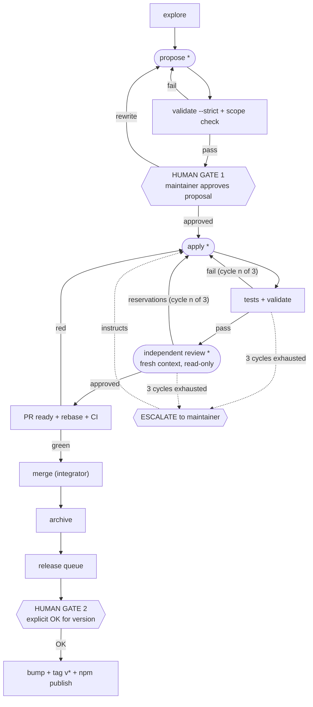
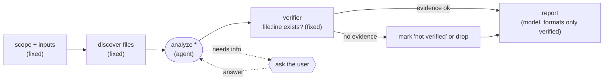

## Context

Motivation and scope: see `proposal.md`. Required behavior: `specs/aep-delivery-graph/spec.md`. Today the flow is prose in `CONTRIBUTING.md` plus the maintainer's habits; `.github/workflows/validate.yml` runs `scripts/validate-skills.mjs`, `npm test` and `openspec validate --all --strict --no-interactive` (OpenSpec pinned at 1.7.0), and `.github/workflows/publish.yml` publishes to npm with provenance when a `v*` tag is pushed, after checking that the tag matches `package.json`. The repository has no pull request template. Branch protection is a GitHub ruleset, not a file; its measured state on 2026-11-23 is in Decision 12.

**Working definition, with sources.** "AEP" here means an Agentic Engineering Platform and stays a **working definition of this project**. It is anchored in two sources and adapted by us; the line between the two is kept explicit.

*From the sources (attributed):*
- Weave Intelligence, ["What is an Agentic Engineering Platform?"](https://weaveintelligence.io/blog/what-is-an-agentic-engineering-platform) (von Grünberg, 2026): an AEP is built and run by a platform engineering team so that engineers and agents develop together; it evolves the IDP and supplies paths, interfaces and guardrails at an organization-set autonomy level. Three layers: Tooling; Path specifications (probabilistic, deterministic and hybrid paths, where a deterministic gate evaluates an agent's candidate and failures route back to the agent); Agent Infrastructure (harness: execution, context, capability, evaluation; governance: identity, agent security, agent observability; models). Four autonomy levels. Audience "typically 50+ developers"; no AEP without a good IDP. Its worked example uses LangGraph as the orchestrator of its reference stack; that is the source's choice, not a requirement we inherit.
- CNCF blog ["Platform engineering for the agentic enterprise"](https://www.cncf.io/blog/2026/07/21/platform-engineering-for-the-agentic-enterprise-managing-applications-resources-and-ai-agents/) (Warusawithana, WSO2, 2026-07-21): applications, resources and AI agents are first-class entities of one platform; every actor has a distinct identity, scoped permissions and an audit trail; context is a first-class capability; reusable skills and built-in agents encapsulate engineering tasks. Conceptual; no implementation detail. As read, it does not define the term "AEP".

*Our adaptation for a consultancy (not stated by either source):* an AEP is the set of reusable, versioned and verifiable capabilities (skills, agents, specs, checks) plus the paths and guardrails through which people and agents deliver engagements to third parties, with evidence and an audit trail per engagement. The mapping table, the consultancy concerns and the gaps are in `proposal.md`. Each document that uses the term says it is a working definition and cites these two sources.

**Gaps, restated for design purposes.** The delivery graph covers the "path specification" and part of the "evaluation" and "governance" layers. It does not give agents distinct identities (one GitHub account is shared, which is why the verdict is a label and why Open Question 3 matters), a sandbox, observability or cost attribution, a context layer, a tool gateway, a models plane, or isolation of client data per engagement. None is promised here.

**Source for the graph framing.** Runkle and Chase, ["3 years of graph engineering with LangGraph"](https://www.langchain.com/blog/3-years-of-graph-engineering-with-langgraph) (2026-07-22). From it, this design uses only: a system is a state machine of nodes (fixed code, one model call, a tool call or a full agent) and edges (deterministic or conditional); agents are rarely DAGs, and cycles (retry, ask, revise after validation, pause for a human and resume) are normal; loops are the simple cyclic case; dynamic fan-out (`Send`) routes work to a runtime-determined number of workers; use a graph for a predictable flow and an agent harness for an open-ended task (its example: deep research moved from predefined workflows to a more agentic loop). The article does not discuss checkpointing, durable execution or interrupts as features, nor the costs of graphs; anything this design says about those is our own reasoning and is labeled so. A second article (Medium) could not be read (HTTP 403) and is not used or cited.

## Goals / Non-Goals

**Goals:**
- One explicit delivery graph that a new agent session can resume from existing artifacts, with typed nodes, labeled edges, bounded cycles and two human gates.
- Permissions per role that an agent can follow and a reviewer can check, with the limits of enforcement stated.
- A level 2 convention that makes every new agent describe its own graph, and a rule that findings without evidence do not count.
- Parallel changes that do not collide on shared files.

**Non-Goals:**
- Implementing the roles, scripts or workflows (they are tasks, after gate 1), adopting a graph runtime, or defining AEP as a standard. See `proposal.md`.

## Decisions

**1. The delivery flow is a graph, and it is level 1.** Nodes and types (`*` agent, `det` deterministic, `human`):

| Node | Type | What it does | Leaves by |
|---|---|---|---|
| `explore` | agent-assisted, optional | Reads the repository and clarifies the idea; writes nothing | to `propose` |
| `propose` | agent `*` | Writes the change folder under `openspec/changes/<name>/` | to `validate` |
| `validate` | det | `openspec validate <name> --strict --no-interactive` and the scope check (diff only under the change folder) | pass to `human-gate-1`; fail to `propose` (cycle) |
| `human-gate-1` | human | The maintainer approves the proposal on its draft pull request | approve to `apply`; reject or ask to rewrite to `propose` |
| `apply` | agent `*` | Implements the tasks in the change's worktree, ticking `tasks.md` | to `test-and-validate` |
| `test-and-validate` | det | `node scripts/validate-skills.mjs`, `npm test`, `openspec validate --all --strict --no-interactive` | pass to `review`; fail to `apply` (cycle, counted) |
| `review` | agent `*` | Independent, fresh context, read-only; returns `approved` or `changes-requested` with evidence | approved to `pr-and-ci`; reservations to `apply` (cycle, counted) |
| `pr-and-ci` | det | Pull request leaves draft, rebase on `main`, required checks run | green to `merge`; red to `apply` |
| `merge` | det | Integrator merges when the conditions hold | to `archive` |
| `archive` | det | `openspec archive <name>`: the delta moves into `openspec/specs/` | to `release-queue` |
| `release-queue` | det | The merged change is added to the list of unreleased changes | batch ready to `human-gate-2` |
| `human-gate-2` | human | The maintainer approves a version | OK to the release change (bump, tag `v*`, `publish.yml`); no OK, the queue waits |

The interrupt-and-resume pattern of the article applies at both gates: the graph pauses with its state saved in the pull request and resumes when the maintainer answers, possibly in a different agent session.

**Graph engineering is a discipline here.** The twelve nodes are typed, the edges are labeled and conditional where needed, the state is explicit (Decision 5), cycles are bounded (Decision 4) and the human gates are interruptions that pause and resume. Nothing executes this graph except Claude Code subagents, the OpenSpec CLI, scripts and CI (Decision 11).

**Diagram (Mermaid).** Solid arrows are the forward path, dashed arrows are cycles, hexagons are human gates, rounded boxes with `*` are agent nodes.

The graph is a **cyclic** state machine: three loops (`propose`/`validate`, `apply`/`test-and-validate`, `apply`/`review`) and two interrupts (the gates). It is not a DAG, which is the point of the article's argument for explicit cycles.

*Alternatives considered:* (i) keep the flow as prose in `CONTRIBUTING.md` (rejected: it does not say who may write where, nor bound retries, so agents improvise); (ii) adopt a graph runtime such as LangGraph to execute it (not adopted: see Decision 11); (iii) a single agent harness that decides its own steps (rejected: the flow is predictable, which is when the article recommends a graph).

**2. Four roles, and what each can touch.**

| Role | Node(s) | May write | Must not |
|---|---|---|---|
| Proposal author | `propose` | Only `openspec/changes/<name>/` | Edit code, `README.md`, `marketplace.json`, `package.json`; start `apply` before gate 1 |
| Implementer | `apply` | The worktree of its own change, on `claude/<name>` | Merge, tag, publish, bump the version, push to `main` |
| Reviewer | `review` | Nothing (read-only tools, fresh context) | Edit, commit, push, merge; review its own work |
| Integrator | `merge`, `archive`, `release-queue` | Merge and archive, only on an approved verdict plus green CI | Write code, merge on red CI or a human request for changes, bump or tag |

Enforcement is layered and honest: what is **enforced by tools** (the reviewer's tool allowlist, as in the `stacks-auditor` precedent), what is **enforced by CI** (validation, tests, the scope check), what is a **repository setting** the maintainer controls (branch protection on `main`, required checks) and what rests only on **instructions** to agents. The roles page says which is which. As the `stacks-auditor` change found, an allowlist without `Write` or `Edit` does not stop `Bash` from changing files, so "read-only" for the reviewer is an allowlist plus a deny list plus an instruction, not a guarantee.

*Alternative:* a single "do everything" agent per change (rejected: the author reviewing its own work removes the independence that decision (a) relies on).

**3. The independent reviewer, and why its verdict is a label.** The reviewer is a subagent with a new context and read-only tools. It reads the diff, the change's specs, `tasks.md` and the checks' output, and returns one verdict. GitHub does not let the account that opened a pull request approve it, and agent sessions may share the maintainer's account, so a native "Approve" review may be unavailable. The maintainer approved carrying the verdict by a label (`review:approved` or `review:changes-requested`) and a verdict comment with the evidence, which the integrator reads. A human `Request changes` review always wins over the label. *Alternatives:* native GitHub approvals only (rejected: may be impossible for the same account); the verdict kept only in the session (rejected: lost at the next resume).

**4. Cycle bounds: 3, then the maintainer.** The maintainer set 3 for the apply loop. The count includes both `test-and-validate` failures and `review` reservations (one counter per change, stored on the pull request as a label `cycle:1..3`), so a change cannot loop forever by alternating failure types. The maintainer approved the same bound of 3 for `propose`/`validate`. After the bound, the change gets `needs:maintainer` and agents stop. *Alternatives:* unbounded retries (rejected: cost and drift); separate counters per loop (rejected: allows up to 6 cycles without a human seeing it).

**5. State is in artifacts that already exist.** `tasks.md` records what work is done; the pull request records the node (labels such as `node:apply`, `node:review`, `node:gate-1`), the cycle count, the verdict and the gate decisions (comments from the maintainer); `.openspec.yaml` records the schema and the creation date and stays as it is. A resuming session reads those three and needs no memory of earlier sessions, which is what makes the pause-and-resume at gates real. *Alternatives:* a `state.json` per change (rejected: a second source of truth that drifts from the pull request); an external database (rejected: no hosting, and it breaks "clone and work").

**6. Parallelism, expressed as fan-out.** Changes are independent branches, so the delivery graph is run once per change, in its own worktree. This is the article's dynamic fan-out in a simple form: the number of changes in flight is only known at runtime, and each runs the same subgraph. The reduce step is the merge queue: changes merge one at a time, each rebased on `main` and re-validated, so the specs under `openspec/specs/` stay consistent. Shared files: `README.md` (catalog rows) and `marketplace.json` (plugin entries) take additive, per-change edits that rebase mechanically; `package.json`'s `version` is changed only by a release change after gate 2, so two feature changes never conflict on it. *Alternative:* serialize all changes (rejected: wastes the parallelism that agents give); bump versions per change (rejected: conflicts and implies a release that gate 2 has not approved).

**7. Published is "merged"; release is a batch behind gate 2.** Merging to `main` makes plugins available in the marketplace, so for skills and agents "published" is satisfied at merge. The npm package (`agent-skills` CLI) is different: `publish.yml` publishes with provenance when a `v*` tag is pushed. A tag is irreversible in practice (a published npm version cannot be reused), so it needs an explicit OK that names the version. The release queue is the list of changes merged since the last tag; the maintainer **accepted** deriving it from `git log` since the last tag and the archived changes, with no extra file. *Alternative:* release on every merge (rejected by the maintainer's decision (b)).

**8. Level 2: each agent has a graph.** In `design.md` a new agent or skill lists nodes with a type (fixed code, model call, agent), edges (deterministic or conditional), state, cycles with limits and human interruptions. For an agent that produces findings, the graph ends with a **verifier node that is code, not a model**: it checks that each finding has `file:line` evidence and that the file exists and has that line (and, where cheap, that the cited text matches). This is the generalization of what the `stacks-auditor` already does with its engine: the model reads, the engine reports with evidence. Output with no evidence is dropped or marked "not verified" and never counts toward a verdict. Example, for an auditor-style agent:

The delivery graph itself already follows the convention, as the table in Decision 1 shows. A graph section is required for agents and skills, not for every change (a docs-only change has no agent). *Alternative:* a single global rule "agents must verify" (rejected: not checkable; naming a node is).

**9. Deterministic helper for what the repository can check alone.** A small Node script (no new dependency) with subcommands: `scope <change>` (the diff against `main` touches only `openspec/changes/<change>/` while the change has no gate 1 approval marker), `tasks <change>` (every `- [ ]` is ticked, and reports the first that is not), and `evidence <file>` (each `file:line` reference in a report exists). It covers the deterministic nodes that today would be an agent's judgment. The maintainer approved running it in `validate.yml`; that workflow edit is an implementation task (task 3.3), not part of this proposal. It does not call GitHub. Gate decisions, labels and CI status stay with the integrator reading the pull request. *Alternative:* implement the whole integrator as a script against the GitHub API (rejected for now: needs a token and a policy on which identity merges; see Open Questions).

**10. Documentation location.** `CONTRIBUTING.md` gets a short section that links to `docs/aep/delivery-graph.md`, which holds the diagram, the table of roles and the label names. `CONTRIBUTING.md`'s step 6, "the maintainer runs `/opsx:archive`", changes to "the integrator archives after merge". A pull request template (`.github/pull_request_template.md`) carries the checklist that mirrors the graph's gates. The draw.io source is `docs/aep/delivery-graph.drawio` in the design system's palette (`#0b1326` background, `#171f33`/`#222a3d` surfaces, `#45464d` borders, `#dae2fd` text, `#2fd9f4`/`#7bd0ff`/`#5bbfae`/`#8dc63f` accents; Space Grotesk and Manrope, Geist Sans as fallback), kept editable.

**11. No graph runtime (LangGraph/LangChain).** Graph engineering is a **design discipline** in this change: typed nodes, conditional edges, explicit state, bounded cycles and human interruptions. There is no LangGraph or LangChain dependency, service or code. Execution is by Claude Code subagents, the OpenSpec CLI, deterministic scripts and CI. The maintainer asked whether LangChain is a tool or only the flow; the answer is the flow.

Alternatives considered. Pros and cons marked "(ours)" are our own assessment; the LangChain article does not discuss checkpointing, durable execution or the costs of graphs.

| Option | Pros | Cons |
|---|---|---|
| A. No runtime; graph as specification (chosen) | No new dependency, service, hosting or credentials (ours). Works today with what exists. The article itself values the graph as a way to make explicit where the model chooses and where the system enforces behavior, which a specification gives. Keeps "clone and work" | Nothing enforces the graph mechanically: roles, cycle counts and gates rest on instructions, labels, CI and repository settings (ours). No durable execution: a session that dies mid-node is resumed by reading the pull request and `tasks.md`, not from a checkpoint (ours). Parallelism is bounded by how many sessions the maintainer runs |
| B. Adopt LangGraph (state, conditional edges, cycles, pause for human input and resume, a runtime for the nodes) | The article presents graphs as the way to impose explicit paths on agents, with cycles and human pauses as first-class patterns, and `Send` for runtime fan-out. A runtime would enforce the topology and cycle limits in code and could run unattended (ours, from general knowledge of such runtimes, not from the article) | Needs a Python or JS service, hosting, credentials for GitHub and a model API, and a policy on which identity acts (ours). Duplicates what Claude Code subagents and CI already execute (ours). Makes the repository depend on a vendor's framework for a flow of twelve nodes. The article is a vendor's account of its own framework |
| C. Single-agent harness that decides its own steps | The article recommends a harness for open-ended tasks; least to build | Delivering a change here is predictable, which is where the article recommends a graph. No bounded cycles, no explicit gates, no separation between author and reviewer, so decision (a) loses its independence (ours) |

**Reevaluation criteria (objective; meeting one starts a new OpenSpec change that evaluates option B, it does not adopt it).** Reconsider when any of these holds, checked at each human gate 2:
1. **Unattended or durable execution.** Orchestration must run outside an interactive session (scheduled or event-triggered runs that must survive a restart or wait days for a human) and not only be resumed by a person starting a session.
2. **Parallelism above N.** More than 5 changes in flight at the same time on a sustained basis (over two consecutive release batches), so that per-change sessions become the bottleneck.
3. **Resume failures.** Two or more cases in one release batch where a new session could not tell the node, cycle count or verdict from the pull request and `tasks.md`.
4. **Escalation rate.** More than a quarter of the last 20 merged changes exhausted the 3-cycle limit, which suggests the bounds need mechanical enforcement.
5. **Engagement audit.** A consultancy engagement needs an audit trail or enforcement that git and pull requests cannot provide.

The maintainer accepted the thresholds as a starting point; they are not measured quantities and can be adjusted later. No criterion commits the project to adopting a runtime.

**12. Protection of `main` and of the tags, as a recommended release prerequisite.** Measured on 2026-11-23, the ruleset `main-protection` (branch) has: `deletion`; `non_fast_forward`; `required_status_checks` with an **empty** list and strict `true`; `code_scanning` (CodeQL, `high_or_higher`) while the CodeQL default setup is `not-configured`, so the rule would block any pull request that has no bypass; `pull_request` with 0 required approvals; an administrator bypass in mode `always`. There is **no ruleset for tags**, and the tags `v0.2.0` to `v0.5.0` exist. Because the checks list is empty, the protection does not yet stop a red pull request, and the `always` bypass lets an administrator push to `main` directly.

*Recommended configuration (documented here, applied by the maintainer, not part of this diff):*

| Item | Recommended | Why |
|---|---|---|
| Required status checks | List the 15 Actions jobs: `validate`; `test` on ubuntu, macos and windows with Node 20, 22 and 24 (9 jobs); `docs-generator` on Node 20 and 24; `azure-terraform-stacks` on Node 20 and 24; `azure-terraform-stacks-deep` | An empty list makes "green CI" in the graph meaningless. The exact check names are confirmed from a recent run before saving the ruleset |
| CodeQL | Enable the default setup with languages `actions` and `javascript-typescript` | Makes the `code_scanning` rule satisfiable, so it does not block every pull request |
| Administrator bypass | Mode `pull_request`, not `always` | An administrator may bypass through a pull request but cannot push straight to `main` |
| Tag ruleset | A ruleset on `refs/tags/v*` restricting creation, update and deletion | Published tags are immutable, and a tag (which triggers `publish.yml`) cannot be created by accident |
| Publish gate (extra) | A GitHub environment with a required reviewer on the npm publish job | A second human check before an irreversible publish. It needs edits to `publish.yml` and the trusted publisher configuration: a separate workflow change, outside this one |

*Honest limit.* The agents act under the maintainer's identity, who is an administrator. These rules prevent accidents and shortcuts (a direct push, a retagged release, a merge with a red check); they do **not** stop a hostile or compromised agent, because the same identity can edit the ruleset. Real separation needs an identity of its own for the agents (a GitHub App or a bot account without administrator permission and without the right to create tags). This is recommended as a future change, and it is the condition under which release automation could be considered. Until then, release stays behind gate 2 and manual.

*Alternative:* leave protection undocumented and rely on instructions (rejected: the graph's "green CI" and "no push to `main`" claims would rest on nothing). *Alternative:* require approvals (rejected for now: a single maintainer cannot approve their own pull request, and 0 approvals is a deliberate setting).

**13. Engagement workspaces: one private repository per engagement, from a template.** Terms. **Engagement**: a client project (an assessment, a design, a delivery). **Workspace**: the isolated area that holds everything of one engagement: the client's artifacts, the state of the runs, the reports, credentials scoped to that client only, an audit log, and a retention and disposal policy. Decision: each engagement gets its own **private repository**, created from a template. The skills and agents of this public repository are **installed into it by the CLI**; nothing of the client enters this repository, and the template is not stored here yet.

| Option | Pros | Cons |
|---|---|---|
| A. One private repository per engagement, from a template (chosen) | Access, credentials, audit log and disposal are per client; the repository can be archived or deleted when the engagement ends; the catalog stays public and generic | A template to maintain (a future change); several repositories to administer; updates to the catalog are pulled by the CLI, not shared by git |
| B. One private monorepo with a folder per engagement (rejected) | One place to administer | Risk of leaking one client's data to another (a wrong path, a shared search or context, an agent with the whole tree); access is all or nothing; disposal of one client means rewriting history |
| C. Engagement data inside this public repository (rejected) | Simplest | Violates confidentiality; the repository is public and MIT |

This change **does not create the template** (out of scope). It is a future change, listed in Open Questions. The per-engagement isolation gap stays listed as a gap of this repository; the decision says where it will be closed, not that it is.

**14. Context budget, measured with a tokenizer.** Every capability (a skill or an agent) has a **loaded-context cost** in tokens and a **declared budget**. What counts: for a skill, what Claude loads when it triggers (its `SKILL.md`, and referenced files that are loaded with it); for an agent, the size of the agent file itself plus what it pre-loads through `skills:`. A deterministic helper compares the measured cost with the declared budget and fails when the cost is above it.

*What the official documentation says (read on 2026-11-23, [token counting](https://platform.claude.com/docs/en/build-with-claude/token-counting)):* the Messages API has a token counting endpoint (`/v1/messages/count_tokens`) that takes the same inputs as message creation (system prompt, tools, images, PDFs) and returns `input_tokens`; the page shows requests with an `x-api-key` header, so **it needs an API key**; counting is **free** but subject to requests-per-minute limits by usage tier (5,000, 10,000 and 20,000 for the Start, Build and Scale tiers); the count is described as **an estimate** that can differ by a small amount from the real use, and may include tokens added by Anthropic that are not billed; the count is made under the tokenizer of the `model` passed, and Claude 4.7 and later models use a newer tokenizer that produces **about 30 percent more tokens** than earlier models for the same text, so counts must be redone for the model that will be used. The page names no offline tokenizer.

*Offline option (read on the same date, [README of `anthropic-tokenizer-typescript`](https://github.com/anthropics/anthropic-tokenizer-typescript), the source of the npm package `@anthropic-ai/tokenizer`):* it says the algorithm is no longer accurate from the Claude 3 models and "can be used as a very rough approximation", and suggests relying on `usage` in the response body. The repository is archived (read-only) per the GitHub page. So there is **no accurate offline tokenizer for current models** in what was read, and this package is not used. What was not read: the npm package page itself (only the registry listing of its versions, latest `0.0.4`), and the API reference page of `count_tokens` (the token counting guide links to it).

*Method, tool-agnostic.* The requirement does not name a tool. (1) **Official count**: when an API key is available (for example run manually and locally by the maintainer), the endpoint above, with the model named. (2) **Offline estimate**: in CI without a key, an approximation (for example bytes divided by 4), always **labeled as an approximation**. (3) **Never** present the estimate as an exact measure, and **always record the method next to each number** (`official:<model>` or `estimate:bytes/4`, with the date). A budget check in CI uses the estimate with a stated margin; the official count is the reference when disputed. No runtime dependency is added to the repository.

*Example only, not a measurement:* `plugins/azure-terraform-stacks/skills/azure-terraform-stacks/SKILL.md` has 12,258 bytes in `main`, which is about 3,065 tokens by the bytes/4 estimate (`estimate:bytes/4`). Given the roughly 30 percent difference between tokenizer generations, the real figure for a current model may be higher. The real measurement uses the method defined above.

*Alternative:* adopt the npm tokenizer package in CI (rejected: not accurate for current models per its own README, and it adds a dependency). *Alternative:* no budget (rejected: pre-loading skills through an agent's `skills:` has a cost that nothing makes visible).

**15. Roles as installable subagents: a future change with a trigger.** Approved as its own later change. Trigger: after the release of the agents CLI and after the `stacks-auditor` fix (pull request #17) is merged. The first role is the **independent reviewer**, which is read-only and so does not need an identity that can write. The implementer and the integrator, which write, come later, and depend on the agent identity of Decision 12.

## Risks / Trade-offs

- [The "independent" reviewer is the same model family and may share blind spots] → It is a fresh context with read-only tools and must cite evidence, which reduces but does not remove correlated errors; the maintainer's gate 1 and the CI remain; a human `Request changes` always overrides.
- [Autonomous merge and archive after a model's verdict is a real delegation of trust] → Bounded by green required CI, rebase on `main`, 3-cycle limit, no release power, and the maintainer's ability to revoke by turning on branch protection or removing the label rule. It is the maintainer's decision (a); this design records its risks, not a doubt about it.
- [Labels are mutable by anyone with write access, so the verdict can be forged] → The integrator also reads the verdict comment and the actor who wrote it; where it matters, the maintainer can require a CODEOWNERS or branch-protection review. See Open Question 3 (integrator identity and protection), a prerequisite for release automation.
- [Roles are instructions, and `Bash` can change files despite allowlists] → The scope check and CI catch writes outside scope on the branch; the roles page states what is and is not enforced; only repository settings give a hard guarantee.
- [Process overhead for tiny changes (a typo)] → Level 1 applies to changes under `openspec/`, `plugins/`, `src/` and workflows; the maintainer decided that documentation-only fixes do not skip `propose`, so even a typo fix has a branch, a draft pull request, review and CI; the cost is accepted, and the proposal for such a change can be a few lines.
- [The article is a vendor's blog about its own framework] → Used only for framing (nodes, edges, cycles, fan-out, graph versus harness), not for claims about effectiveness; the spec makes no such claim.
- [Protection rules are applied by the maintainer, and the maintainer's identity can change them] → Stated as the honest limit in Decision 12; the rules are documented as a checklist, and separation needs an identity of the agents' own.
- [The context estimate is approximate and tokenizers differ across model generations] → Every number carries its method; CI uses a labeled estimate with a margin and never claims exactness; the official count is the reference.
- [A repository per engagement multiplies administration] → Accepted for isolation; a template (future change) keeps setup uniform.
- [Release queue derived from `git log` is approximate] → It lists merged changes since the last tag; the maintainer still approves a named version at gate 2.

## Migration Plan

1. Merge this proposal's pull request after gate 1 (it adds only a change folder).
2. At apply, add the documentation, helper and template; no workflow or published artifact changes.
3. The next change after this one is the first to run the graph end to end; record what the graph got wrong in that pull request and adjust the spec by a follow-up change.
4. Rollback: delete `docs/aep/`, the helper and the template; `CONTRIBUTING.md` goes back to its previous section. No data or published package is affected.

## Open Questions

Resolved by the maintainer (now in the spec and in Decisions 7, 11 to 15): (1) the same 3-cycle bound for `propose`/`validate`; (2) the verdict as a pull request label plus a comment; (4) the `delivery-check` helper runs in `validate.yml`, as an implementation task; (5) documentation-only fixes do not skip `propose`; (6) the release queue is derived from `git log`; (7) roles as installable subagents are a future change with a trigger; (8) engagement workspaces are one private repository per engagement; (9) the reevaluation thresholds are accepted as a starting point.

Still open (future changes or maintainer actions, none blocks this change):

- **Applying the protection checklist** (Decision 12): the maintainer edits the ruleset, enables CodeQL and adds the tag ruleset; the exact check names are confirmed from a CI run.
- **Agent identity** (a GitHub App or a bot account without administrator or tag rights): a future change; the condition for any release automation.
- **Protected publish environment** (`publish.yml` and the trusted publisher): a separate workflow change.
- **Engagement repository template**: a future change.
- **Roles as subagents, starting with the reviewer**: a future change after the agents CLI release and the `stacks-auditor` fix.
- **Where the declared context budgets live** (a committed file, or a field next to each capability) and the margin used by the CI estimate: decided at apply, task 3.4.
