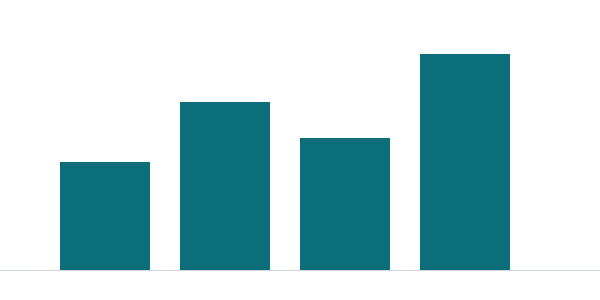

# Contexto

Hoje os pacientes marcam consultas por telefone ou mensagem. Em média, cada recepcionista gasta **2 horas por dia** confirmando e remarcando horários, e 18% das consultas terminam em falta sem aviso.

A pesquisa com 312 clínicas mostrou três necessidades principais:

1. Marcar e remarcar sem falar com a recepção.
2. Receber lembretes no canal preferido do paciente.
3. Ver a agenda de vários profissionais em uma única tela.

## O que já existe

O sistema de prontuário guarda a agenda de cada profissional, mas não a expõe para fora. A integração com calendários externos é feita à mão, com exportação de arquivos `.ics` uma vez por dia.

> O maior pedido das clínicas não é uma agenda nova: é parar de digitar a mesma consulta em dois lugares.

# Proposta

A agenda online será um módulo do sistema atual, com uma página pública por clínica e uma API para os aplicativos parceiros.

## Fases do lançamento

| Fase | Público | Duração | Meta de adesão |
|------|---------|--------:|---------------:|
| 1 | Clínicas com prontuário ativo | 2 meses | 40% |
| 2 | Clínicas sem prontuário | 2 meses | 25% |
| 3 | Aplicativos parceiros (API) | 2 meses | 10 parceiros |

## Arquitetura

O módulo lê e grava na mesma base da agenda atual. Os lembretes saem por uma fila, para não atrasar a marcação.

```text
paciente → página da clínica → API de agenda → base atual
                                     ↓
                              fila de lembretes → e-mail, SMS, WhatsApp
```



### Sincronização com calendários externos

A sincronização usa assinaturas de calendário em vez da exportação diária, o que reduz o atraso de até 24 horas para menos de 5 minutos.

# Custos e retorno

O custo total estimado é de R$ 420 mil, detalhado no Anexo B. O retorno vem da redução de faltas e do tempo de recepção liberado.

- **Desenvolvimento:** R$ 310 mil
- **Infraestrutura no primeiro ano:** R$ 60 mil
- **Treinamento e suporte:** R$ 50 mil

# Riscos

O piloto em Curitiba, com 12 clínicas, mostrou que os profissionais só aderem quando a agenda online respeita os bloqueios que eles já fazem no sistema atual. Por isso a fase 1 começa pelas clínicas que já usam o prontuário (veja as [fases do lançamento](#s-fases-do-lancamento)).

| Risco | Probabilidade | Impacto | Mitigação |
|-------|---------------|---------|-----------|
| Baixa adesão dos profissionais | Média | Alto | Respeitar os bloqueios existentes; treinamento por clínica |
| Falhas na sincronização | Baixa | Médio | Assinaturas com nova tentativa automática e alerta |
| Custo de SMS acima do previsto | Média | Baixo | Priorizar e-mail e WhatsApp; SMS só sob demanda |
